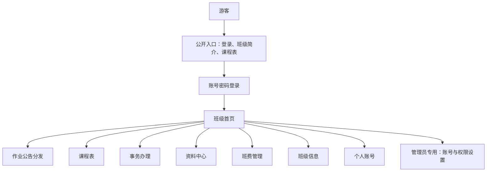
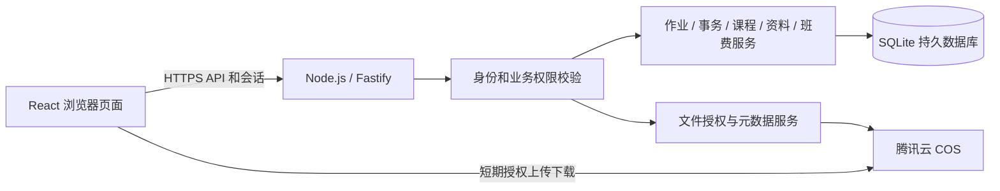

# 班级网站第一版设计说明

日期：2026 年 11 月 6 日

状态：用户已确认设计，并明确授权直接开始代码实现；随后确认管理员自动拥有完整班费管理权限，本文已同步该规则。

## 1. 用途与范围

建设供一个班级日常使用的网站，把作业、课程、班级事务、资料和班费记录集中管理。手机端优先，同时适配电脑。学生能快速找到今天的课程和自己的待办，班委能发布、维护、统计，管理员负责账号及权限。

第一版交付独立运行的前后端、数据库迁移、初始化工具、测试和部署说明。实际使用的数据由管理员录入；开发演示数据明确标为示例，与正式环境分离。暂用“班级空间”作为可修改的网站名称。

### 用户已确认的要求

- 七个一级模块：首页、作业公告分发、课程表、事务办理、资料中心、班费管理、班级信息。
- 只有管理员、班委、学生、游客四个身份组；游客即未登录状态，不创建游客账号。
- 所有账号由管理员统一创建；管理员分配身份和专项权限。
- 游客只可访问登录入口、班级简介和只读课程表。
- 管理员、班委可编辑发布作业，作业可以带附件，也可以要求学生提交附件。
- 事务办理包含活动报名、信息登记、班级材料收集及进度统计、结果导出。
- 资料中心仅管理员、班委可以上传维护，登录成员可以查阅下载。
- 所有上传、下载的业务文件统一存储于腾讯云对象存储 COS。
- 班费只记账，不进行支付、收款、转账；管理员自动拥有完整班费管理权限，班委中只允许指定人员维护账目。
- 课程表独立成模块，手动编辑，每周固定重复。
- 班级信息保留简介、班委分工、值日安排和基础成员信息。
- 首页依次突出今日课程、我的待办、最新作业和快捷入口。
- 使用独立项目方案，前端 React + TypeScript，后端 Node.js，配合数据库和 COS。

### 本文补充的默认设计

以下是为了能实施而作出的设计选择，尚不等同于用户逐项指定：SQLite 数据库、Fastify 后端、具体视觉样式、草稿与归档规则、提交及调课细节、文件限制、会话期限和审计规则。审阅本文时可以调整。

第一版面向单个班级；不加入聊天、自动排课、考试成绩、在线支付、开放注册、微信登录、邮件或短信通知。课表以人工编辑为主，不加入 Excel 导入。

## 2. 实现方案比较

| 方案 | 特点 | 选择 |
| --- | --- | --- |
| 独立前后端项目 | 源码和部署自主可控，账号和业务权限由自己的后端处理，文件使用 COS；需配置服务器运行环境 | 用户已选择 |
| Sites 托管网站 | 发布预览便捷，需适配托管平台的后端和存储运行方式，文件仍需另行接入 COS | 未选择 |

独立项目采用 React、TypeScript、Vite 和 React Router 构建页面；Fastify 提供 Node.js API。第一版建议 SQLite，适用于单班级、单服务实例的规模，数据库放在服务器持久磁盘，并提供备份与恢复说明。数据操作封装在服务和仓储层，未来可迁移数据库。

SQLite 选择依据是当前单班级规模及较低维护成本，而非已知用户人数。若未来改为多班级、多实例或高写入并发，重新评估 PostgreSQL。[SQLite 官方适用范围](https://www.sqlite.org/whentouse.html)

## 3. 页面与视觉设计

### 页面入口

### 视觉方向

采用清爽、实用的浅色界面：浅灰底色、白色卡片、深色正文、青绿色主按钮。建议主色 `#0F766E`，背景 `#F6F8FA`，正文 `#18212F`。状态使用文字、图标和颜色共同表达。中文优先使用系统字体，不依赖外部字体服务。

UI UX Pro Max 用于辅助检查布局、触控目标、表单反馈和可读性。其教育类检索结果偏儿童化，因此不直接照搬卡通字体、立体装饰和营销落地页结构；本项目采用适合日常办事的界面。

电脑端左侧固定导航，右侧内容区，顶部显示当前页面和用户入口。手机端使用顶部标题与导航抽屉；首页提供常用快捷入口，不把七个模块全部塞入底部导航。按钮触控区域至少 44×44，正文默认 16px；提供清晰键盘焦点、字段标签和错误提示。

### 首页布局

顶部显示班级名称、日期和问候，下方依次为“今日课程”“我的待办”“最新作业”和快捷入口。电脑端课程和待办可并排；手机端纵向排列。待办包含未完成的作业与事务，按临近截止排序，无截止时间的事项排在后面。

管理员、班委按权限看到发布入口和办理进度；“我的待办”仅面向属于班级学生名册的账号，避免将管理人员无意义地计为未提交。数据为空时解释如何开始；加载、失败和重试状态均有明确界面。

游客的公开入口展示简介、课表入口和登录按钮；不展示成员、作业摘要、班费金额及内部统计。未登录访问受限页面跳转登录，并记住原页面以便登录后返回。

## 4. 身份与授权

账号只有一个主身份：`admin`、`committee` 或 `student`。班委仍属于学生名册，参与作业、事务和缴费登记；管理员不计入学生名册，第一版不设管理员同时作为学生的例外。游客是无会话状态。

管理员自动拥有完整班费管理权限，无需额外授权。指定班委通过 `financeManage` 权限标记获得班费维护能力，不增加第五个身份组。管理员可以授予、撤销该标记；标记只能授予班委，变更为其他身份时自动清除。`financeManage` 仅表示班委专项授权，API 的 `canManage` 表示实际权限：管理员为真，班委仅在标记为真时为真，学生为假；游客无班费访问权限。

| 操作 | 管理员 | 班委 | 学生 | 游客 |
| --- | --- | --- | --- | --- |
| 查看公开简介和课表 | 是 | 是 | 是 | 是 |
| 查看首页及已发布作业、事务、资料 | 是 | 是 | 是 | 否 |
| 编辑发布作业、事务 | 是 | 是 | 否 | 否 |
| 上传及维护资料、编辑课表和班级内容 | 是 | 是 | 否 | 否 |
| 提交自己的作业、办理自己的事务 | 不作为提交对象 | 是 | 是 | 否 |
| 查看完整作业与事务提交统计 | 是 | 是 | 否 | 否 |
| 查看他人的提交附件 | 是 | 是 | 否 | 否 |
| 查看班费收支公示和已公开凭证 | 是 | 是 | 是 | 否 |
| 查看个人缴费详情 | 全部 | 指定财务班委看全部，其他班委看自己 | 自己 | 否 |
| 新增、修订、作废班费账目和缴费登记 | 是 | 仅有 financeManage 的班委 | 否 | 否 |
| 创建、修改缴费事项，上传凭证和切换公示状态 | 是 | 仅有 financeManage 的班委 | 否 | 否 |
| 查看完整修订记录、私密及历史凭证、导出完整班费数据 | 是 | 仅有 financeManage 的班委 | 否 | 否 |
| 创建停用账号、重置密码、分配身份权限 | 是 | 否 | 否 | 否 |

班费管理权限统一按“管理员，或具有 `financeManage` 标记的班委”判断，覆盖账目、缴费事项、缴费登记、凭证及公示状态的维护，以及完整记录查阅和导出。普通班委、学生和游客的权限保持不变。

所有权限在服务端校验；隐藏前端入口仅用于改善界面。私密资源的详情、统计、导出、上传授权和下载授权使用同一套业务权限。管理员与班委可维护其他管理员或班委发布的作业、事务、资料及班级内容，操作记入日志；班费遵循上述管理员自动授权、班委专项授权规则。

## 5. 各模块行为

### 5.1 作业公告分发

作业字段：标题、课程、要求、附件、是否需要提交、提交说明、可选截止时间、是否允许补交、状态、发布人及更新时间。

- 状态为草稿、已发布、已归档。草稿仅管理人员可见；撤回恢复为草稿，但保留原提交记录。归档作业可查询，禁止新提交。
- 发布对象为当前学生名册，发布时保存对象快照。新加入的学生可查看作业，但不自动加入旧作业未交名单；管理员、班委可显式调整参与对象。
- 无需提交的作业不生成“未交”状态；需要提交时支持说明文字和附件，并由发布者设置附件是否必填。
- 截止前允许重新提交，系统保留历史版本，以最近一次有效提交计完成。无截止时间则可提交至归档；截止后按补交选项处理。
- 使用服务端时间判断截止，完成记录的时间为提交确认成功的时间。开始上传不等于完成提交。
- 修改截止时间不更改历史提交时间；是否迟交按提交时的截止时间记录。已开放提交后，不允许将提交要求改为更严格；需要时发布新作业。
- 管理人员查看已交、未交、补交名单，下载有权访问的文件并导出汇总。第一版不实现评分或在线批改。

参与对象的默认生命周期：首次发布建立快照，撤回后再发布沿用原快照；调整对象必须显式操作并留痕。删除参与资格使用“免交”状态，不物理删除提交记录。停用账号或转为管理员时，尚未完成的要求自动标为免交并退出当前未交分母，已经完成的历史记录保留；恢复账号不会自动恢复旧要求，由管理人员显式恢复。已免交对象不能再提交，但有效登录后可查本人历史。当前进度排除免交项，历史操作保留，导出列出免交状态避免丢失记录。

已归档作业仍可由登录成员查阅已发布详情和公告附件；参与者可查看本人的历史提交，管理人员可查全部提交，所有提交均只读。撤回后学生无法查看最新草稿，但可从个人提交历史看到提交时的标题、时间和自己的文件；不能读取草稿后续改动。归档记录如需再开放，恢复为已发布时必须重新检查截止时间与参与对象，操作记入日志。

### 5.2 课程表

使用“星期 × 节次”的固定周模板，录入一次循环展示。每节配置开始、结束时间；支持星期一至星期日，课程默认可连续占多个节次。课程包括名称、教师、教室和备注。

学生端采用专用节次网格，电脑端看整周，手机端默认当日课程卡片并可切换整周。时间段和课程冲突在保存时明确提示并阻止同班同节重叠。

2026-11-08 按用户反馈调整：全班始终展示单个当前周模板，不再按日期自动切换版本。管理员、班委编辑当前课表后立即生效；可以另存备用模板，只有显式点击应用才切换。旧日期模板全部保留，初次迁移按当天原本有效的模板初始化当前选择。第一版不支持单双周、按教学周组合或自动排课。临时停课或调课通过指定日期的例外记录覆盖当天安排，绑定所属模板并在切换后保留；调课、模板编辑及应用均检查冲突。

首页与公开课表读取同一份经过日期例外计算的课程结果。网站按 Asia/Shanghai 处理日期与“今天”。学期起止日、放假范围由管理人员设置；没有课程或在休课日期显示无课状态。

已调研 FullCalendar 和 Schedule-X；它们默认采用实际时间轴。因本项目每周固定、按节次人工维护，第一版选择专用节次网格，更便于展示午休和连堂，不引入大型日历依赖。[FullCalendar 周日视图](https://fullcalendar.io/docs/timegrid-view)、[Schedule-X 视图说明](https://schedule-x.dev/docs/calendar/views)

公开课表只返回显示课程所需的名称、时间、教室、授课教师显示名及公开调课说明，不包含账号 ID、手机号、学生名单、内部管理备注。

### 5.3 事务办理

支持活动报名、信息登记、班级材料收集三类事项，共用发布和提交流程。字段包括名称、说明、对象、可选截止时间、是否允许截止后办理和状态。表单支持短文本、长文本、单选、多选和附件，字段可设必填。

草稿、发布、归档及参与对象生命周期、历史可见性规则与作业一致。收到第一份提交后，已有字段的名称、类型、选项与必填要求冻结；只允许追加非必填字段。撤回为草稿仍受此限制；每份提交保存对应表单版本，旧答案按原版本解释和导出。表单外的事项名称、说明可修改并保留更新时间。截止前允许修改本人的提交，保留最新记录及修改时间；截止后按事项设置办理。

管理人员查看已办理、未办理情况与结果，导出表格和材料。第一版不含多级审批、在线支付、名额抢占或自动外部通知。

### 5.4 资料中心

支持分类、标题、说明、文件、常用链接、置顶、搜索、按时间筛选和归档。管理员、班委维护；学生、班委、管理员可查阅已发布资料。

更新文件生成新版本及更新时间，不覆盖旧对象。默认向同学提供当前版本，管理人员可查看历史版本。外部链接只接受 http/https；打开时明确是外部链接。PDF、PNG、JPEG、WebP 提供站内预览，其余文件下载后查看。

资料归档表示下架：归档资料从学生列表隐藏，学生不可取得新的下载链接；管理员、班委仍可查询和下载历史版本，并可恢复发布。已签发短期链接遵循第 7 节的到期规则。

### 5.5 班费管理

支持余额总览、收支台账、缴费事项和个人缴费登记、票据附件、筛选和表格导出。金额统一按人民币“分”保存和计算，界面显示元，拒绝零金额、负数和超过两位小数的输入。

- 余额 = 期初金额 + 有效收入 - 有效支出。期初金额为可审计的期初记录；历史账目产生后，调整期初采用修订记录。
- 缴费事项只表达需记录的金额和对象；“待收”不计入余额。允许部分缴费，多次实际到账可累计登记。
- 一次实际缴费登记在同一数据库事务中产生唯一收入记录。禁止通过汇总或重复请求重复入账；提交使用幂等键。
- 与缴费登记关联的收入在台账中只读，只能从对应缴费登记入口修订或作废；同一事务同步更新个人累计实缴、待缴金额及关联收入的有效版本。其他独立收入、支出从台账入口修改。重复修订请求保持幂等，乐观锁阻止覆盖他人更改。实缴超过应缴金额时如实记账并单独显示超缴金额，待缴金额最低为零。
- 所有收支属于已经发生的事实记录，不接入支付渠道，不显示在线付款按钮。
- 已生效账目修改产生修订版本；作废保留原值、操作者、时间和原因。余额只计算当前有效版本。
- 登录成员查看班级收支总表与明确用于公示的凭证；个人缴费详情默认仅本人、管理员、指定班委查看。学生看到的缴费汇总不展开其他人的记录；公示接口隐藏缴费人身份和关联个人记录的 ID，对个人缴费产生的收入统一显示“班费收入”。
- 未公开凭证仅管理员和指定财务班委可查看、下载，普通班委和学生即使是缴费本人也只能查看本人的缴费字段；凭证经管理员或指定财务班委选择“用于公示”后才向全体登录成员开放。切换公示状态属于班费写操作，管理员和指定财务班委均可执行，并可查看全部凭证和授权情况。列表、详情、导出及 COS 签名均遵守此规则。
- 普通班委可以看公开账目和自己的缴费情况，无法登记、更改、作废或导出完整个人缴费名单。

### 5.6 班级信息

简介包括班级名称、专业、年级、文字简介与可选照片。简介是公开内容。班委分工、值日安排、成员基础信息仅登录后可见；管理员、班委可以维护展示内容。

成员账号及主身份由管理员管理，班委编辑展示资料不改变账号身份。成员基础信息限姓名、头像和班内职务，不默认展示电话、家庭住址或证件号码。值日按具体日期和负责区域维护；不自动生成复杂轮班。

### 5.7 账号与个人设置

使用管理员指定的唯一登录账号和密码，账号可以用学号但不强制绑定学号规则。支持单个创建与管理员名单模板批量创建，导入先预检重复及必填项，确认后整体创建；无公开注册接口。

初始化首位管理员通过服务器命令完成，初始密码由操作者提供或安全随机生成，不提交到源码，不创建通用固定密码。新账号与密码重置后必须修改密码才能继续访问内部业务页面。

密码使用成熟的带盐密码哈希库；服务端会话通过 HttpOnly Cookie 保存，正式环境启用 Secure 与 SameSite。会话绝对有效期默认 7 天；退出、停用账号、重置密码立即使相关会话失效。身份及权限变更在下一次 API 请求生效。登录限速，错误信息不暴露账号是否存在。写请求校验来源并防止跨站请求伪造。

管理员可以重置、停用账号，不能停用或降级最后一个有效管理员。停用保留历史业务记录，同时阻止登录和新提交。

## 6. 数据与后端结构

主要实体包括：用户、会话、专项授权、班级设置、公开简介、成员资料、值日安排、课程、作息节次、周模板版本、日期例外、作业与参与对象、作业提交版本、事务表单及对象、事务结果版本、资料与版本、班费事项、缴费登记、收入支出版本、文件元数据、审计事件。

数据库通过迁移管理结构，启用外键，关键复合关系设置唯一约束。日期时间按 UTC 存储，纯日期和星期规则以 Asia/Shanghai 解释。写入包含服务端验证和必要的事务；可变记录带版本号，遇到他人同时修改返回冲突，防止静默覆盖。

API 按 `/api/auth`、`/api/public`、`/api/homework`、`/api/timetable`、`/api/affairs`、`/api/resources`、`/api/finance`、`/api/class`、`/api/users`、`/api/files` 分组。公开 API 的字段清单与内部 API 分离，公开页面不复用可能泄漏内部字段的完整数据响应。

## 7. 腾讯云 COS 文件流程

实际业务文件全部放在 COS。SQLite 保存业务记录和文件元数据，包括对象键、原始文件名、大小、内容类型、用途、所有者、关联记录、状态和创建时间。服务器数据库不是用户上传文件的替代存储；不把文件内容放到浏览器 localStorage。

使用私有读写桶，授权决定在后端完成；浏览器只得到短期、指定对象和指定操作的授权。长期密钥只存在服务器环境变量或密钥服务，不能进入前端构建产物。配置准确的站点来源 CORS。预签名能力及最小权限依据：[腾讯云 Node.js 预签名 URL](https://cloud.tencent.com/document/product/436/36121)、[腾讯云最小权限原则](https://cloud.tencent.com/document/product/436/38618)。

### 上传

1. 浏览器选择文件并提交元数据及目标业务记录，后端验证角色、目标权限、截止状态、数量和大小限制。
2. 后端生成随机且不可重用的对象键，创建待上传记录并签发默认 10 分钟有效的指定对象上传授权；不允许客户端自选已存在对象键。默认使用未启用版本控制的业务桶，将禁止覆盖请求头签入上传请求，防止已确认对象被同一链接重放覆盖；上传失败的重试沿用待上传记录，已存在的完整对象进入确认流程。[COS PUT Object](https://cloud.tencent.com/document/product/436/7749)
3. 浏览器直传 COS，展示进度与失败重试。
4. 上传完成后请求后端确认；后端通过 HEAD 检查实际对象大小、元数据和身份，并对可识别格式核验文件头，重新验证业务权限及截止状态，再幂等完成关联。不能仅信任浏览器上报的 Content-Type。只有确认成功才显示“提交成功”。
5. 未确认对象不允许下载、不计作已交。上传授权过期且经过 24 小时宽限后，待上传和未关联对象通过维护命令清理；清理与确认通过状态转换互斥且可重试。替换附件生成新键，保留仍被历史记录引用的旧文件。

默认单文件 20 MiB，每次业务提交最多 5 个附件，可由管理员调整。允许常用办公文档、PDF、图片、TXT、CSV 和 ZIP；文件类型、扩展名和大小在前后端双重验证，下载文件名安全编码，HTML、脚本及可执行文件不作为可内联预览内容。

### 下载与预览

每次下载、预览或批量导出先按关联业务记录验证权限。下载签发默认 5 分钟有效的读取链接，预览通过登录会话访问同域内容接口。数据库只保存对象键，不保存过期的签名链接。下载链接属于短期持有者凭证，在有效期内可被持有人使用；注销和撤权会停止新链接发放，但不承诺撤销已经签发的链接或浏览器已读取的内容。

公开简介照片属于显式公开资源，只允许游客通过该资源的读取入口获得当前照片内容。作业提交、内部资料和班费凭证不因为拥有文件 ID 就可访问。

腾讯云对较新存储桶的默认域名浏览器预览有限制。2026-11-08 改为服务端鉴权后从私有 COS 读取并核验图片/PDF 内容，前端 fetch 后使用临时 Blob 预览，关闭时终止未完成请求并释放地址；不再依赖自定义预览域名，不做本地持久存储。接口仅接受已确认、大小及格式签名一致的白名单内容，关闭缓存并限制直接访问响应；Office、ZIP 等格式仍下载后查看。[腾讯云文件预览条件](https://cloud.tencent.com/document/product/436/35153)

Excel 汇总、作业批量 ZIP 等生成文件也采用 COS 保存：服务端鉴权后生成上传，再返回受限下载链接。临时导出对象默认 24 小时到期，可重新生成，不产生永久公开下载地址。

### 未配置 COS 时

页面、账号、课表和无附件业务可以本地验证。附件上传入口明确显示尚未配置，后端返回可理解的配置错误；不会把附件改存另一家服务或假装上传成功。测试环境使用隔离的存储替身测试权限和流程，不充当正式存储。

正式接入需要提供地域、桶名、受限服务器凭据、跨域规则和可选预览域名。凭据通过本机环境配置，不要求写入聊天、文档或代码。真实桶验证上传、下载和删除测试对象后，才能声明 COS 联调完成。

## 8. 运行与维护

前后端开发时分别启动，生产使用同域访问和 HTTPS，静态页面与 `/api` 由反向代理或统一服务入口提供。建议 Node.js 24 系列；依赖在实施时锁定兼容版本。源码位置为 `D:\spxd_web`。

SQLite 只放持久化磁盘，提供一致性数据库备份和恢复命令；COS 对象不与数据库一起复制到源码库。备份导出的数据库如需远程保存，也放入受限 COS 备份前缀。日志不记录密码、会话值、云密钥或完整签名 URL。

按模块组织前后端代码，避免单个文件包含全部业务。目录布局、具体组件库、数据库驱动和测试工具由实施计划确定，遵循本设计的行为及权限约束。

## 9. 验收标准

- 游客只获得登录、简介和只读课表的数据，直接访问内部 API、文件签名和统计均被拒绝。
- 管理员创建账号并分配身份；停用、密码重置及权限变更按规则生效。
- 管理员、班委发布作业或事务，学生/班委完成自己的提交，管理人员看到准确进度。
- 截止、补交、重新提交、撤回、归档和参与对象快照行为可重复验证。
- 学生无法维护资料、课表、账号或修改账目；普通班委无法修改班费；管理员无需财务标记即可维护全部班费，指定班委通过 `financeManage=true` 获得班费维护权限，操作均保留审计记录。
- 同一笔缴费在重复请求或重试时只入账一次；部分缴费、修订和作废后的余额准确。
- 私密提交和个人缴费详情不会通过列表、详情、导出或文件链接接口泄露给其他学生。
- 固定周模板正确重复，临时调课只影响指定日期，首页与公开课表一致。
- 所有业务文件和生成导出文件走 COS；未配置时明确不可用，接入后验证真实上传、鉴权下载和预览条件。
- 手机及电脑布局可用，表格和课表不破坏页面宽度；表单可键盘操作，错误、空状态与加载状态清楚。
- 使用测试数据验证权限、财务事务、截止逻辑、文件状态机；通过构建检查和浏览器主要流程检查。

## 10. 审阅时重点确认的设计选择

1. 第一版使用 SQLite 和单服务器部署，先覆盖一个班级。
2. 采用浅色青绿色界面、电脑侧栏与手机导航抽屉。
3. 课程表使用专用节次网格，保留指定日期的临时调整。
4. 管理员自动拥有完整班费管理权限，指定班委通过专项标记获得班费维护权限；班费凭证需要由管理员或指定班委明确选择后才公示。
5. 提交对象采用发布时快照；加入时间不同的学生不会自动出现在旧事项的未交名单。
6. COS 真实环境需要后续配置；未接通时附件入口如实显示配置状态。

技术方案选择已经确认；上述设计通过审阅后，再编写实施计划并开始代码实现。
